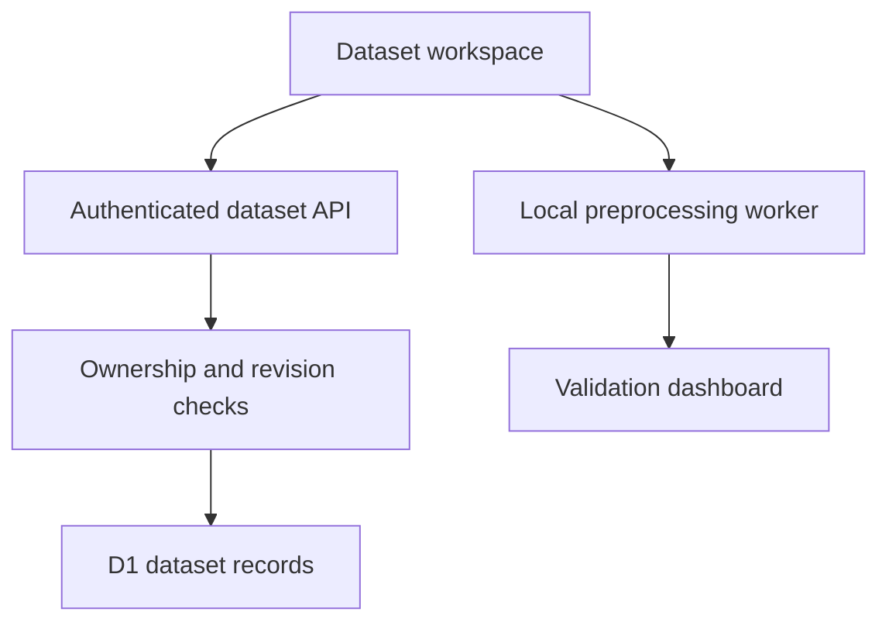

# Architecture

The interface and computational modules are plain JavaScript. Long-running browser calculations use a module worker. The portable HTML embeds the same computational source and runs without a server. Its database actions are disabled.

The hosted application adds a Vinext server and Cloudflare D1. Platform identity reaches server routes through the supplied Sites authentication integration. The server never trusts an account identifier sent in a dataset request body.

`datasets` holds ownership, display metadata, revisions, configuration, and preparation summaries. `dataset_chunks` holds bounded original and prepared content. Original data remain unchanged when a preparation is saved. Parameterized queries constrain every stored-data operation to the authenticated owner.

The numerical core computes binary-outcome discrimination, calibration, decision curves, and fixed-prediction bootstrap intervals. The preprocessing module learns transformations from training observations only. Baseline fitting evaluates held-out observations. None of these methods establishes external validity or clinical readiness.

The default hosting configuration declares logical storage bindings only. It contains no project identifier, account identifier, database identifier, or credential. A developer must configure their own deployment. GitHub Pages can host the client or portable demo, but cannot provide the authenticated dataset API or D1 database.
